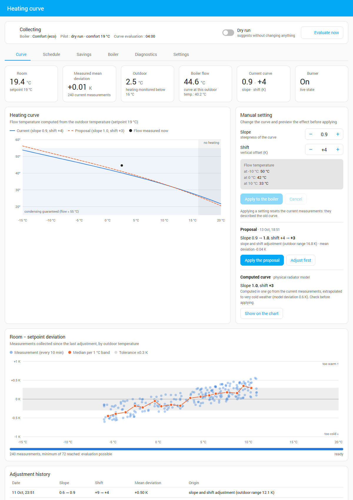
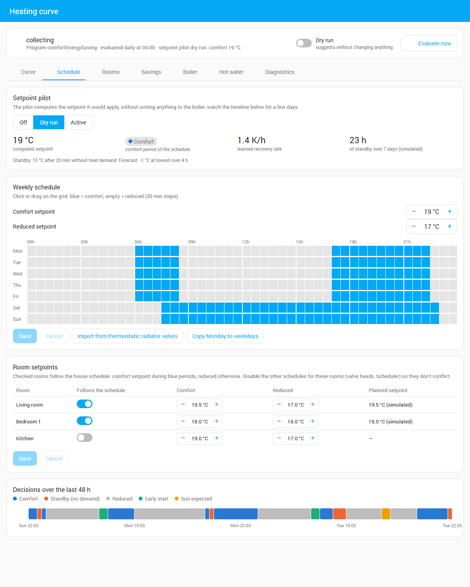
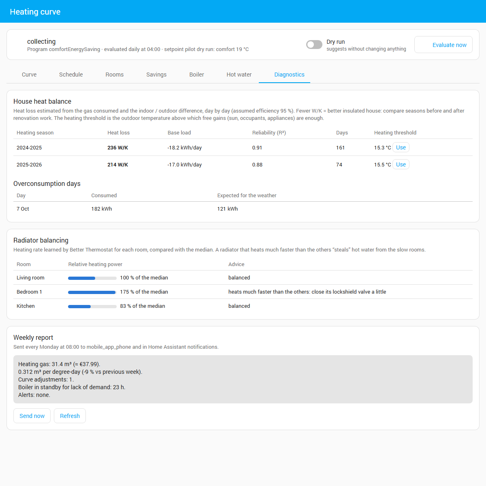
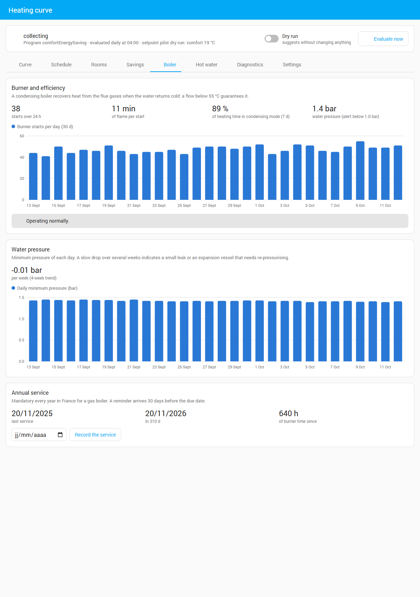

# Viessmann heating curve optimizer (Home Assistant integration)

*[Version française](README.md)*

Automatically tunes the **slope** and **shift** of the heating curve of a Viessmann boiler connected
through ViCare, so that rooms reach their setpoint with the lowest possible flow temperature
(better condensing, longer burner cycles). It also drives the setpoint from a schedule and room demand,
tracks costs, and monitors the boiler.



## How it works

1. Every 10 min the integration records outdoor temperature, room temperature and setpoint, **only**
   in steady state: monitored program active for ≥ 2 h, heating actually ran within the last hour (ViCare *heating* gas
   counter: the pump and burner also run for hot water), outdoor temperature below the heating
   limit, and no strong sunshine (solar filter: sun elevation + cloud coverage from your weather entity).
   If ViCare does not report the current setpoint, it is read from the active program's `number` entity
   (`comfortEnergySaving` → comfort temperature, etc.).
2. **Multi-room mode** (Better Thermostat / Versatile Thermostat): the deviation used is the one of the
   hardest room to heat. Among rooms calling for heat, the coldest one decides; when none calls for heat,
   the margin of the least warm room lets the curve go down. Rooms with an open window are ignored.
3. Every night (04:00) samples are grouped in 1 K outdoor-temperature bins; the Viessmann curve formula
   gives the required flow correction, fitted by least squares:
   - same deviation everywhere → **shift**;
   - deviation depending on outdoor temperature → **slope** (only if outdoor temperature varied by ≥ 5 K).
4. Safeguards: only 50 % of the correction, at most ±0.1 slope and ±3 K shift per day, min/max bounds,
   0.3 K tolerance, outlier clipping.
5. After an adjustment, samples are reset (they described the previous curve).

Proposals are sent as notifications; with the Home Assistant mobile app (`notify.mobile_app_…`) they carry
**Apply** / **Ignore** buttons.

**Computed curve**: a physical radiator model (output ∝ ΔT^1.3) is fitted to the measurements, then the
closest Viessmann curve is proposed. It extrapolates correctly to very cold weather even when measurements
only cover a narrow temperature range, so the curve converges within days.

## Setpoint pilot (off / dry run / active)

The pilot acts on the **active program's setpoint**, like the ViCare app. It applies:

- a **weekly schedule** edited in the panel (30-minute grid), importable from your thermostatic radiator
  valve heads' schedules;
- **per-room setpoints** (comfort / reduced) following the same schedule for the selected rooms
  (Better Thermostat): one schedule for the whole house;
- **demand-based standby**: during comfort periods, standby setpoint (15 °C by default) once no room has
  called for heat for 20 min, immediate return as soon as a room calls for heat;
- **optimal start**: recovery speed learned from past mornings, corrected by the **weather forecast**
  (colder forecast → earlier start);
- **solar anticipation**: setpoint lowered by 1 °C when strong sunshine is forecast.

**ViCare quota**: the Viessmann API allows 1,450 calls per 24 h and HA's ViCare integration already uses about
1,440 of them for its polling (every minute). The pilot, the curve and hot water therefore share a **write budget**
(8 per day by default): a setpoint decrease is only made if enough budget remains to return to comfort, no new
standby within 30 min of the previous one, and an alert fires when the budget is reached. Exceeding the quota blocks
ViCare access for 24 h.

**Freeing the quota**: with the "Refresh ViCare every … min" option (5 recommended), ViCare's automatic polling is
turned off and the optimizer refreshes it itself (~290 calls per day instead of ~1,440, plus a re-read 70 s after each
write). The write budget can then go up to 30-40. Setting the option back to 0 hands polling back to ViCare.

**Boiler schedule**: the panel schedule can be sent to the boiler ("Boiler schedule (ViCare)" card), within its
constraints (slots per day, 10-minute steps), with an optional "normal" step before comfort to warm up in two stages.
It goes through the ViCare integration's connection.

**Hot water**: the tank recharge slots (ViCare schedule) are shown and edited in the Schedule tab.

**Room schedules**: if the [Scheduler](https://github.com/nielsfaber/scheduler-component) integration drives the radiator
valves, their schedules are shown and edited in the Schedule tab, with a warning when a room calls for heat while the
boiler is reduced. An electric heater on a pilot-wire module (no thermostat in HA: it regulates itself) is scheduled
by mode (comfort, eco, off…).

In **dry run** the pilot computes and shows its decisions without writing anything. When **active**, the
original setpoints (boiler and rooms) are saved and restored when switching back to dry run / off.
Safeguards: at least 5 min between writes, at most 48 boiler writes per day.



## Monitoring and diagnostics

- **Alerts** (`binary_sensor` + notification): low pressure, unreachable boiler, frost protection, short
  cycling, **frozen room sensor** (same value for 4 h while the burner keeps starting: samples skipped and
  removed), **overconsumption** (yesterday's gas well above the thermal-model forecast), **slow pressure loss**
  (4-week trend: small leak, expansion vessel), **annual service** due ("Service done" button).
- **Thermal balance**: house heat loss in W/K per heating season, and **heating limit** (outdoor temperature
  above which free gains are enough), applicable in one click.
- **Radiator balancing** from the heating power learned by Better Thermostat; rooms marked "internal gains"
  (kitchen, stove) are left out of the median and their deviation only needs confirming.
- **Weekly report** by notification.



## Costs, bill and Energy dashboard

**Bill forecast** (Savings tab): consumption since the start of the billing period, plus the rest of the year from
a typical monthly profile applied to the reference consumption, compared with the instalments → estimated yearly
settlement. **Gas meter**: a Gazpar (or other meter) sensor can replace the often inaccurate ViCare readings for all
statistics.

Set the gas price per kWh and the m³ → kWh conversion (from your bill) in the options. The integration provides:

- `sensor.…_gas_price` (EUR/m³): pick it as the **price entity** of the gas sources in the Energy dashboard
  (sources = ViCare daily gas consumption sensors);
- **Linky meter**: with a [Conso API](https://conso.boris.sh) token (Enedis consent given on the site, token pasted in the
  Settings, never sent back to the browser), the meter's daily consumption is imported every morning into statistics
  (`heating_curve_optimizer:linky_<PRM>`, up to 3 years of history): « Linky – consommation » source for the Energy
  dashboard, with its cost (`…_cout`, « Linky – coût », at the Settings price), and « Household electricity » card in
  the Savings tab. If the load curve is enabled in the Enedis account, the hourly mean power is imported too
  (`…_puissance`, 4 weeks at first): the household baseload is then measured, not estimated;
- **Electric backup heating** (Versatile Thermostat heaters, or a bare pilot-wire module, e.g. towel rail): kWh and € over 7 and 30 days, room
  humidity and detected showers, in the Savings tab (electricity price in the Settings). « Gas priority » option: a
  pilot-wire heater is switched off while gas heating runs (the heating water already warms it), then restored to the
  mode requested by its schedule; drying after a shower (humidity ≥ 80 %) is not interrupted;
- `sensor.…_heating_gas_cost_today` and `…_hot_water_gas_cost_today` (EUR, reset daily).

## "Heating curve" panel

Sidebar panel (administrators), in English or French depending on Home Assistant's language:

| Tab | Content |
|---|---|
| **Curve** | Current curve + proposal / pending edit / computed curve, condensing zone, measured flow, manual tuning with preview, deviations by outdoor temperature, history |
| **Schedule** | Pilot mode, computed setpoint and reason, weekly grid, import from valve heads, room setpoints, 48-hour decision timeline, status of each tracked room (heat demand, share of time it is limiting) |
| **Savings** | Gas per degree-day (base 18 °C) over 60 days, cost in €, estimated savings; morning recovery analysis |
| **Boiler** | Burner starts and cycles, share of time condensing, pressure and its trend, annual service, hot water (setpoint, tank, gas share, weekly anti-legionella boost) |
| **Diagnostics** | Heat loss (W/K) and heating limit per season, overconsumption days, radiator balancing, weekly report |
| **Settings** | Every integration option (rooms, weather, pilot, costs, bill, alerts, hot water, algorithm) without going through Home Assistant menus |

**Dashboard card**: "Heating curve" card (type `custom:heating-curve-card`) with status, deviation, pilot,
alerts, and Evaluate / Automatic adjustment buttons.



## Installation / update

- **HACS** (custom repository, category Integration): the repository contains `hacs.json`.
- **Manual**: copy `custom_components/heating_curve_optimizer/` into `/config/custom_components/`,
  then restart Home Assistant.

Requirements: Home Assistant 2026.3 or newer, ViCare integration. Configuration: Settings › Devices & services ›
Add integration › "Heating curve optimizer" (ViCare entities are pre-filled), then **Configure** for the options.

## Caveats

- **Thermostatic valves** in the room of the boiler's room sensor: open them fully.
- ViCare writes slope and shift in the same call, reading the other value from its cache: when both change,
  the slope is written first, then the shift once the new slope has been read back.
- Piloted rooms: disable their other schedules (valve heads, Scheduler) so they don't fight each other.
- Cycle length is approximate: ViCare counts burner hours in whole hours.
- Condensing is estimated from the **flow** temperature (no return sensor).

## Development

```bash
# Unit tests (any Python 3.12+)
python -m pytest tests
# Unit + Home Assistant integration tests (Linux or WSL: the HA test harness requires Linux)
bash tools/ha-tests.sh
# README screenshots (fake data, tools/demo): serve the repository, then run
python -m http.server 8765 --bind 127.0.0.1
pwsh tools/screenshots.ps1
```

## License

MIT, see [LICENSE](LICENSE).
