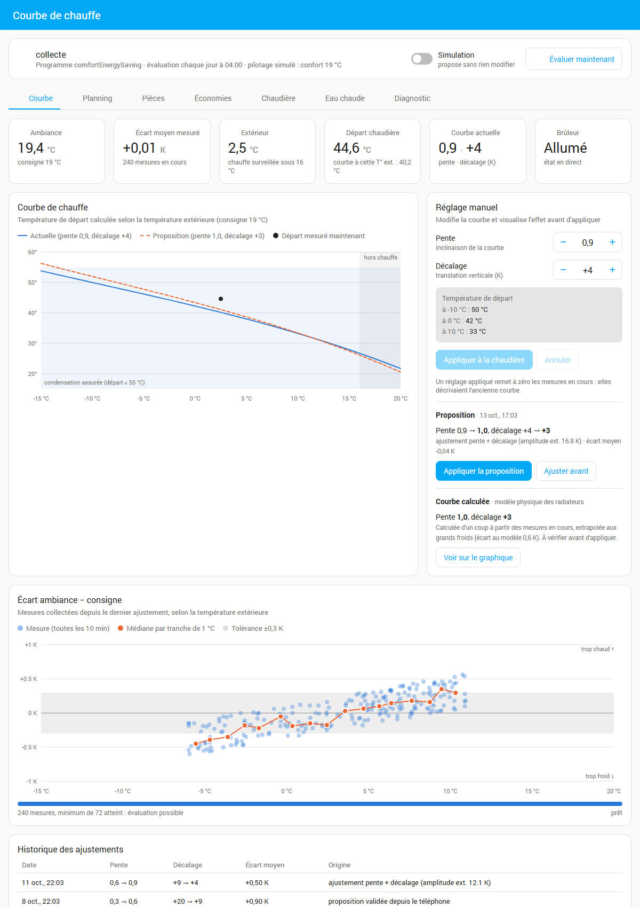
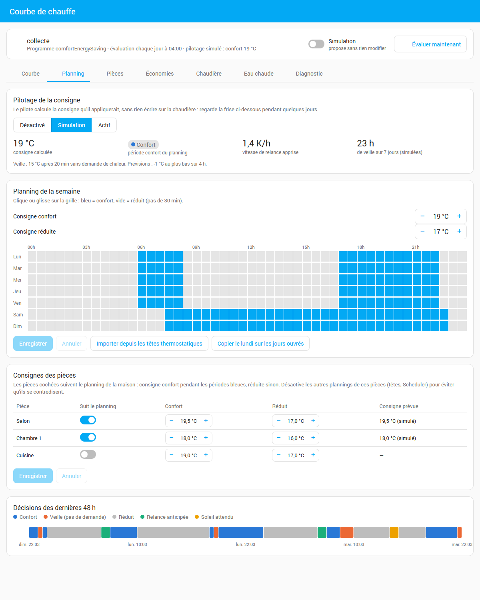
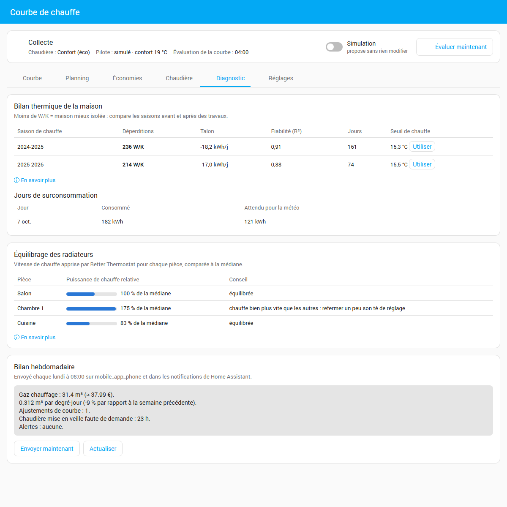

# Optimiseur de courbe de chauffe Viessmann (intégration Home Assistant)

*[English version](README.en.md)*

Ajuste automatiquement la **pente** et le **décalage** de la courbe de chauffe d'une
chaudière Viessmann connectée via ViCare, pour que les pièces atteignent leur consigne avec la
température de départ la plus basse possible (meilleure condensation, cycles brûleur plus longs).
Pilote aussi la consigne selon un planning et la demande des pièces, suit les coûts, et surveille la chaudière.



## Principe

1. Toutes les 10 min, l'intégration enregistre T° extérieure, T° ambiante et consigne, **uniquement**
   en régime stable : programme surveillé actif depuis ≥ 2 h, chauffage ayant réellement tourné dans l'heure (compteur
   ViCare de gaz *chauffage* : la pompe et le brûleur tournent aussi pour l'eau chaude), T° ext. sous le seuil de chauffe,
   et pas de grand soleil (filtre solaire : hauteur du soleil + couverture nuageuse de la météo).
   Si ViCare ne renvoie pas la consigne courante, elle est lue sur l'entité `number` du programme
   actif (`comfortEnergySaving` → température de confort, etc.).
2. **Mode multi-pièces** (thermostats Better Thermostat / Versatile Thermostat) : l'écart retenu est
   celui de la pièce la plus difficile à chauffer. Parmi les pièces qui demandent de la chaleur, la plus
   froide décide ; quand plus aucune ne demande, la marge de la moins chaude permet de baisser la courbe.
   Les pièces fenêtre ouverte sont ignorées.
3. Chaque nuit (04:00), les mesures sont regroupées par tranche de 1 K de T° extérieure, puis la
   formule de courbe Viessmann donne la correction de départ nécessaire, ajustée par moindres carrés :
   - écart identique partout → **décalage** ;
   - écart qui dépend de la T° extérieure → **pente** (seulement si la T° ext. a varié d'au moins 5 K).
4. Garde-fous : 50 % de la correction seulement, ±0,1 de pente et ±3 K de décalage max par jour,
   bornes min/max, tolérance de 0,3 K, écrêtage des écarts aberrants.
5. Après un ajustement, les mesures sont remises à zéro (elles décrivaient l'ancienne courbe).

Les propositions arrivent en notification ; avec l'appli mobile Home Assistant (service `notify.mobile_app_…`),
elles portent des boutons **Appliquer** / **Ignorer**.

**Courbe calculée** : un modèle physique de radiateur (émission ∝ ΔT^1,3) est ajusté sur les mesures, puis la
courbe Viessmann la plus proche est proposée. Elle extrapole correctement aux grands froids même si les mesures
ne couvrent qu'une petite plage de températures, et permet de converger en quelques jours.

## Pilotage de la consigne (désactivé / simulation / actif)

Le pilote agit sur la **consigne du programme actif**, comme l'appli ViCare. Il applique :

- un **planning hebdomadaire** édité dans le panneau (grille par pas de 30 min), importable depuis les
  plannings des têtes thermostatiques ;
- les **consignes de chaque pièce** (confort / réduit) qui suivent ce même planning, pour les pièces cochées
  (Better Thermostat) : un seul planning pour toute la maison ;
- la **veille sur demande** : en période confort, consigne de veille (15 °C par défaut) quand aucune pièce
  ne demande de chaleur depuis 20 min, retour immédiat dès qu'une pièce réclame ;
- la **relance optimale** : vitesse de remontée apprise sur les relances passées, corrigée par la
  **prévision météo** (froid annoncé → relance plus tôt) ;
- l'**anticipation solaire** : consigne baissée d'1 °C quand un soleil franc est prévu.

**Quota ViCare** : l'API Viessmann accepte 1 450 appels par 24 h et l'intégration ViCare de HA en consomme déjà
environ 1 440 pour ses relevés (toutes les minutes). Le pilote, la courbe et l'eau chaude partagent donc un
**budget d'écritures** (8 par jour par défaut) : une baisse de consigne n'est faite que s'il reste de quoi revenir
au confort, pas de nouvelle veille dans les 30 min qui suivent la précédente, et une alerte prévient quand le budget
est atteint. Dépasser le quota bloque l'accès ViCare pendant 24 h.

**Libérer le quota** : avec l'option « Rafraîchir ViCare toutes les … min » (5 conseillé), l'interrogation automatique
de ViCare est coupée et l'optimiseur la rafraîchit lui-même (~290 appels par jour au lieu de ~1 440, et une relecture
70 s après chaque écriture). Le budget d'écritures peut alors monter à 30-40. Remettre l'option à 0 rend la main à ViCare.

**Planning de la chaudière** : le planning du panneau peut être envoyé à la chaudière (carte « Planning de la chaudière
(ViCare) »), en respectant ses contraintes (nombre de plages par jour, pas de 10 min), avec un palier « normal »
facultatif avant le confort pour monter en deux temps. Il passe par la connexion de l'intégration ViCare.

**Plannings des pièces** : si l'intégration [Scheduler](https://github.com/nielsfaber/scheduler-component) pilote les têtes
thermostatiques, leurs plannings s'affichent et se modifient dans l'onglet Planning, avec une alerte quand une pièce
demande de la chaleur alors que la chaudière est en réduit.

En **simulation**, le pilote calcule et affiche ses décisions sans rien écrire. En **actif**, les consignes
d'origine (chaudière et pièces) sont mémorisées et remises au retour en simulation / désactivé.
Garde-fous : 5 min minimum entre deux écritures, 48 écritures par jour au plus pour la chaudière.



## Surveillance et diagnostic

- **Alertes** (entité `binary_sensor` + notification) : pression basse, chaudière injoignable, antigel,
  cycles courts, **surconsommation** (gaz de la veille nettement au-dessus de la prévision du bilan thermique),
  **baisse lente de pression** (tendance sur 4 semaines : petite fuite, vase d'expansion),
  **entretien annuel** à prévoir (bouton « Entretien effectué »).
- **Bilan thermique** : déperditions de la maison en W/K par saison de chauffe, et **seuil de chauffe**
  (T° extérieure au-dessus de laquelle les apports gratuits suffisent), applicable en un clic.
- **Équilibrage des radiateurs** à partir de la puissance de chauffe apprise par Better Thermostat ; les pièces
  marquées « apports internes » (cuisine, poêle) sont exclues de la médiane et leur écart n'est qu'à confirmer.
- **Bilan hebdomadaire** par notification.



## Coûts, facture et tableau Énergie

**Prévision de la facture** (onglet Économies) : consommation depuis le début de la période de facturation, plus le
reste de l'année selon un profil mensuel type appliqué à la consommation de référence, comparée aux mensualités →
montant estimé de la régularisation. **Compteur de gaz** : un capteur Gazpar (ou autre compteur) peut remplacer les
relevés ViCare, souvent imprécis, pour toutes les statistiques.

Le prix du kWh de gaz et la conversion m³ → kWh (facture) se règlent dans les options. L'intégration fournit :

- `sensor.…_prix_du_gaz` (EUR/m³) : à choisir comme **entité de prix** des sources gaz du tableau Énergie
  (sources = consommations de gaz ViCare du jour) ;
- **Chauffage électrique d'appoint** (radiateurs Versatile Thermostat, ex. sèche-serviettes) : kWh et € sur 7 et 30 jours,
  humidité de la pièce et douches détectées, dans l'onglet Économies (prix de l'électricité dans les Réglages) ;
- `sensor.…_cout_du_gaz_chauffage_aujourd_hui` et `…_eau_chaude_aujourd_hui` (EUR, remis à zéro chaque jour).

## Panneau « Courbe de chauffe »

Panneau dans la barre latérale (administrateurs), en français ou en anglais selon la langue de Home Assistant :

| Onglet | Contenu |
|---|---|
| **Courbe** | Courbe actuelle + proposition / réglage en cours / courbe calculée, zone de condensation, départ mesuré, réglage manuel avec aperçu, écarts par T° extérieure, historique |
| **Planning** | Mode de pilotage, consigne calculée et raison, grille hebdomadaire, import depuis les têtes, consignes des pièces, frise des décisions sur 48 h, état de chaque pièce suivie (demande de chaleur, part du temps où elle est limitante) |
| **Économies** | Gaz par degré-jour (base 18 °C) sur 60 jours, coût en €, économie estimée ; analyse des relances du matin |
| **Chaudière** | Démarrages et cycles du brûleur, part du temps en condensation, pression et sa tendance, entretien annuel, eau chaude (consigne, ballon, part du gaz, montée anti-légionelle) |
| **Diagnostic** | Déperditions (W/K) et seuil de chauffe par saison, jours de surconsommation, équilibrage des radiateurs, bilan hebdomadaire |
| **Réglages** | Toutes les options de l'intégration (pièces, météo, pilotage, coûts, facture, alertes, eau chaude, algorithme), sans passer par les menus de Home Assistant |

**Carte de tableau de bord** : carte « Courbe de chauffe » (type `custom:heating-curve-card`) avec l'état, l'écart,
le pilotage, les alertes, et les boutons Évaluer / Ajustement auto.

## Entités créées

| Entité | Rôle |
|---|---|
| `switch.…_ajustement_automatique` | **Éteint = simulation** (propositions en notification). Allumé = applique les ajustements. |
| `select.…_pilotage_de_la_consigne` | Désactivé / Simulation / Actif |
| `switch.…_montee_anti_legionelle_hebdomadaire` | Monte l'eau chaude à 60 °C une fois par semaine puis remet la consigne |
| `button.…_evaluer_maintenant` | Évaluation immédiate |
| `button.…_entretien_effectue` | Enregistre l'entretien annuel (date + heures brûleur) |
| `binary_sensor.…_alerte_chaudiere` | Problèmes en cours (liste en attribut) |
| `sensor.…_etat` | État (collecte, en attente, proposition…) + dernière proposition en attributs |
| `sensor.…_consigne_pilotee` | Consigne calculée par le pilote (mode et raison en attributs) |
| `sensor.…_ecart_moyen_ambiance_consigne`, `…_echantillons` | Mesures en cours |
| `sensor.…_demarrages_bruleur_24_h`, `…_duree_moyenne_de_cycle_bruleur_24_h` | Suivi du brûleur |
| `sensor.…_prix_du_gaz`, `…_cout_du_gaz_…_aujourd_hui` | Tableau Énergie |

Réglages : onglet **Réglages** du panneau, ou Paramètres › Appareils et services › Optimiseur de courbe de chauffe › Configurer
(sections Pièces et météo, Pilotage, Coûts et rapport hebdomadaire, Alertes, Eau chaude, Algorithme).

## Installation / mise à jour

- **HACS** (dépôt personnalisé, catégorie Intégration) : le dépôt contient `hacs.json`.
- **Manuel** : copier `custom_components/heating_curve_optimizer/` dans `/config/custom_components/`,
  puis redémarrer Home Assistant.

Prérequis : Home Assistant 2026.3 ou plus récent, intégration ViCare.

## Points d'attention

- **Robinets thermostatiques** de la pièce de la sonde chaudière : les ouvrir à fond.
- ViCare écrit pente et décalage dans le même appel en relisant l'autre valeur dans son cache :
  quand les deux changent, la pente est écrite, puis le décalage une fois la nouvelle pente relue.
- Pièces pilotées : désactiver leurs autres plannings (têtes, Scheduler) pour éviter qu'ils se contredisent.
- La durée de cycle est approximative : ViCare compte les heures brûleur en heures entières.
- La condensation est estimée sur la température de **départ** (pas de sonde de retour).

## Développement

```bash
# Tests unitaires (n'importe quel Python 3.12+)
python -m pytest tests
# Tests unitaires + intégration Home Assistant (Linux ou WSL : le harnais HA exige Linux)
bash tools/ha-tests.sh
# Captures d'écran du README (données fictives, tools/demo) : servir le dépôt puis lancer
python -m http.server 8765 --bind 127.0.0.1
pwsh tools/screenshots.ps1
```

## Licence

MIT, voir [LICENSE](LICENSE).
